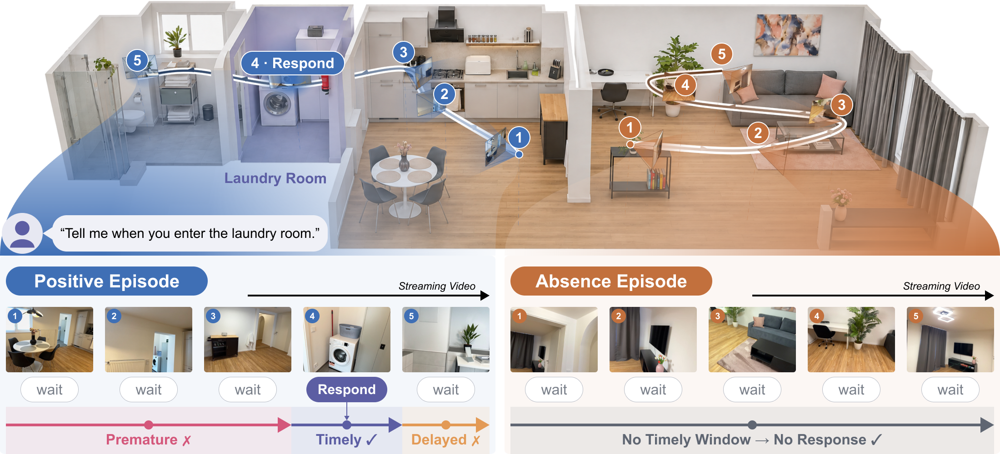

<div align="center" style="font-family: charter;">

<h1>🌊 <i>Thinking in Streams</i>:</br> Proactive Spatial Reasoning with Vision-Language Models</h1>

<p align="center">
  <a href="">Junyoung Hong</a> &nbsp;·&nbsp;
  <a href="">Minsu Kim</a> &nbsp;·&nbsp;
  <a href="">Jaehyun Kim</a> &nbsp;·&nbsp;
  <a href="">Jeonghwan Cho</a> &nbsp;·&nbsp;
  <a href="">Jiwoo Lee</a> &nbsp;·&nbsp;
  <a href="">Seon Joo Kim</a>
</p>

<p align="center">
  Yonsei University
</p>

<p align="center">
  <a href="https://arxiv.org/abs/2611.25865"></a>
</p>



<p align="justify"><i>Recognizing when a requested spatial condition holds in streaming video can require maintaining and updating spatial knowledge across changing viewpoints. We study this capability through proactive spatial reasoning, where a model receives a query in advance and determines whether and when to respond as the stream unfolds. We introduce ProSpace-Bench, comprising nine tasks across object, camera, and scene reasoning, and ProSpace-Train for supervised training. To support spatial decisions, we propose ProSpace-VLM, which injects explicit geometric encodings estimated causally from incoming frames into intermediate VLM layers, using the existing KV cache as spatial memory and spatial token selection for efficient streaming. Experiments reveal a substantial gap between VLMs and humans, while ProSpace-VLM improves timely responses and correct abstention over fine-tuned baselines. Analyses examine how ProSpace-VLM represents previously observed spatial information across changing viewpoints.</i></p>

</div>

---

## 📢 News

- **[2026-11-20]** Paper released on arXiv: [Thinking in Streams](https://arxiv.org/abs/2611.25865).
- **[2026-11-19]** Released 🤗 [ProSpace-Bench](https://huggingface.co/datasets/shamanneo/ProSpace-Bench), 🤗 [ProSpace-Train](https://huggingface.co/datasets/shamanneo/ProSpace-Train), 🤗 [ProSpace-VLM](https://huggingface.co/shamanneo/ProSpace-VLM), and the code.

## 📌 Overview

- **ProSpace-Bench**: 3,636 streams, nine tasks. A model watches a 1 fps stream with a standing request and has to respond at the right second, or stay silent when the event never happens.
- **ProSpace-Train**: supervised training streams, a balanced 100K set and an extended 400K set.
- **ProSpace-VLM**: a streaming VLM with explicit geometric encodings injected into its intermediate layers.

## ⚙️ Setup

```bash
git clone https://github.com/shamanneo/prospace && cd prospace
bash scripts/setup.sh --habitat      # environments, CUT3R; --habitat adds the Matterport3D renderer
```

Then download the benchmark and the checkpoint, and build the frames from the official datasets: [docs/data.md](docs/data.md). Manual install, requirements and troubleshooting: [docs/setup.md](docs/setup.md).

## 📊 Evaluate

```bash
bash scripts/eval.sh prospace-vlm 0,1,2,3          # GPU ids; one GPU also works
bash scripts/eval.sh prospace-vlm-tss 0,1,2,3      # with Spatial Token Selection
bash scripts/eval.sh qwen3-vl-8b 0,1,2,3           # another model
bash scripts/eval.sh --list                        # all models
```

Results go to `results/<model>/` and the scores are printed at the end. Runs are resumable: run the same command again if it stops. `LIMIT=20` runs only the first 20 streams per GPU for a quick test. Other models need their own environment: [runners/README.md](runners/README.md).

## 🔥 Train

```bash
bash scripts/train.sh prospace-vlm 0,1,2,3         # prints the command to evaluate the result
```

Details and the other trainable models: [docs/train.md](docs/train.md).

## 🎯 Scoring

Each cell is `timely / abstention`: the share of positive streams answered inside the timely window, and the share of absence streams where the model never responds. To score your own model, write one JSON line per stream with `task`, `episode_id` and `response_i` (the response second, or `null`), then run `python scripts/score.py <file or folder>`.

## 🙏 Acknowledgements

ProSpace-VLM is built on [Qwen2.5-VL](https://github.com/QwenLM/Qwen2.5-VL) and uses [CUT3R](https://github.com/CUT3R/CUT3R) as its geometry encoder.
ProSpace-Bench and ProSpace-Train are built from [ScanNet](http://www.scan-net.org/), [ScanNet++](https://kaldir.vc.in.tum.de/scannetpp/), [CA-1M](https://github.com/apple/ml-cubifyanything), and [Matterport3D](https://niessner.github.io/Matterport/), rendered with [Habitat-Sim](https://github.com/facebookresearch/habitat-sim).
We thank the authors of these projects and of the baseline models for releasing their code and data.

## 📄 License

The code in this repository is released under the [Apache License 2.0](LICENSE). ScanNet++, ScanNet, CA-1M and Matterport3D keep their own terms of use; this repository does not redistribute their data. CUT3R, Qwen2.5-VL and the other models keep their own licenses.

## 📝 Citation

```bibtex
@misc{hong2026thinkinginstreams,
      title={Thinking in Streams: Proactive Spatial Reasoning with Vision-Language Models},
      author={Junyoung Hong and Minsu Kim and Jaehyun Kim and Jeonghwan Cho and Jiwoo Lee and Seon Joo Kim},
      year={2026},
      eprint={2611.25865},
      archivePrefix={arXiv},
      primaryClass={cs.CV},
      url={https://arxiv.org/abs/2611.25865},
}
```
