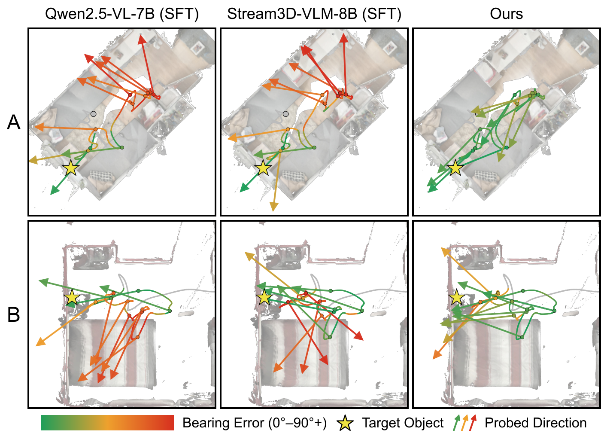

# Object permanence

Reproduces the object permanence analysis of the paper for ProSpace-VLM: a linear probe reads the direction of an object from the model's state after the object has left the view.

<p align="center"></p>

The code reproduces the Ours column.

Run from the repository root in the `prospace` environment, after [docs/data.md](../../docs/data.md).

```bash
# 1. frames of the validation scenes used here (the rest are benchmark and training frames)
python analysis/permanence/frames.py --dataset scannetpp --src <ScanNet++ root>
python analysis/permanence/frames.py --dataset scannet   --src <ScanNet root>
python analysis/permanence/frames.py --dataset ca1m      --src <CA-1M root>

# 2. camera poses and object positions, from your copy of the datasets
python analysis/permanence/truth.py --dataset scannetpp --src <ScanNet++ root>
python analysis/permanence/truth.py --dataset scannet   --src <ScanNet root>
python analysis/permanence/truth.py --dataset ca1m      --src <CA-1M root>

# 3. model states (GPU, about 50 minutes on three H200 GPUs)
bash analysis/permanence/run.sh 0,1,2

# 4. probe error, read-out accuracy, rotation correlation and error curve -> results/permanence/
python analysis/permanence/probe.py

# 5. the two top-view examples (the mesh is optional)
python analysis/permanence/topview.py A --mesh <ARKitScenes>/raw/<split>/47331084/47331084_3dod_mesh.ply
python analysis/permanence/topview.py B --mesh <ARKitScenes>/raw/<split>/45261495/45261495_3dod_mesh.ply
```

- The streams are listed in `streams.jsonl.gz`, and the md5 of their frames in `frames.tsv.gz`.
- Without `--mesh`, the top view draws the CUT3R points of the stream as the floor plan.
- The model states are recomputed on your GPU, so the numbers can differ from the paper in the last digit.
